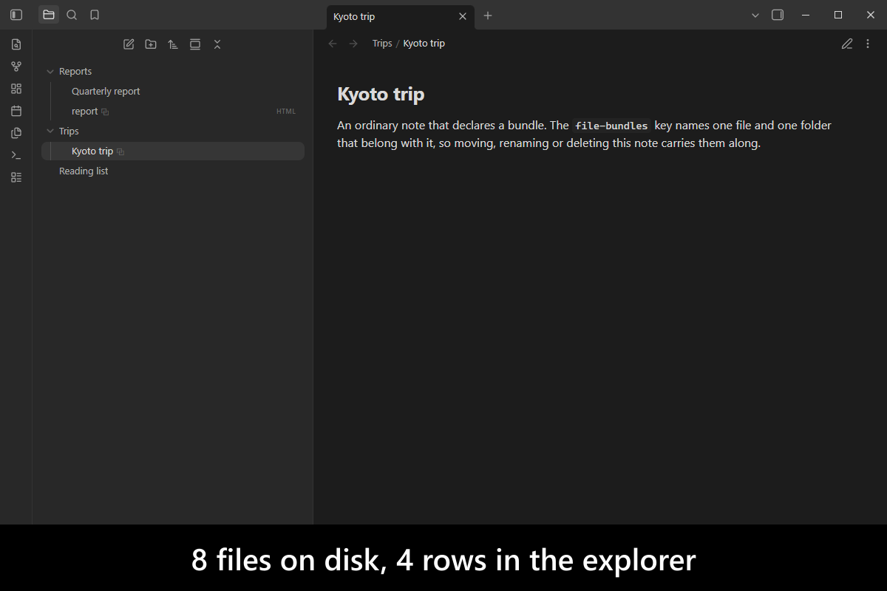
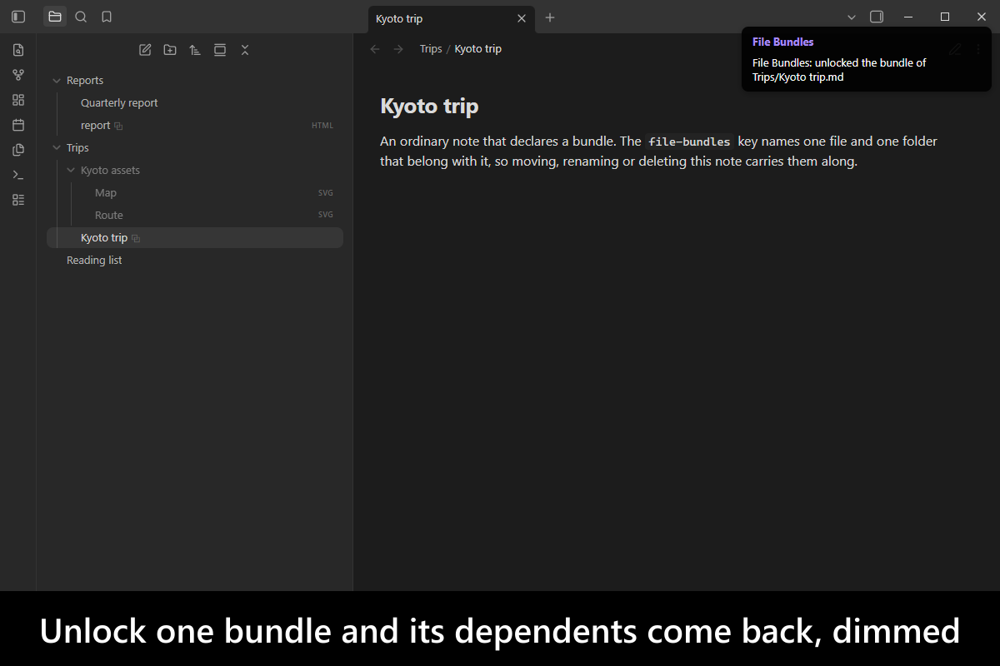
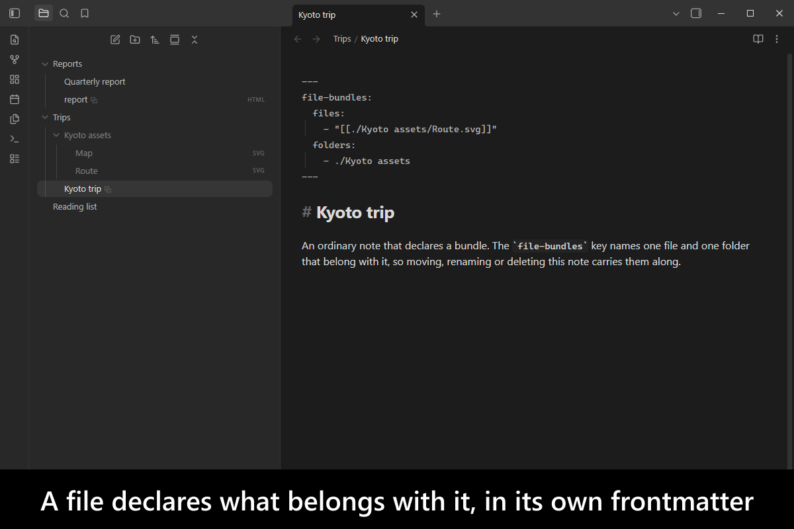
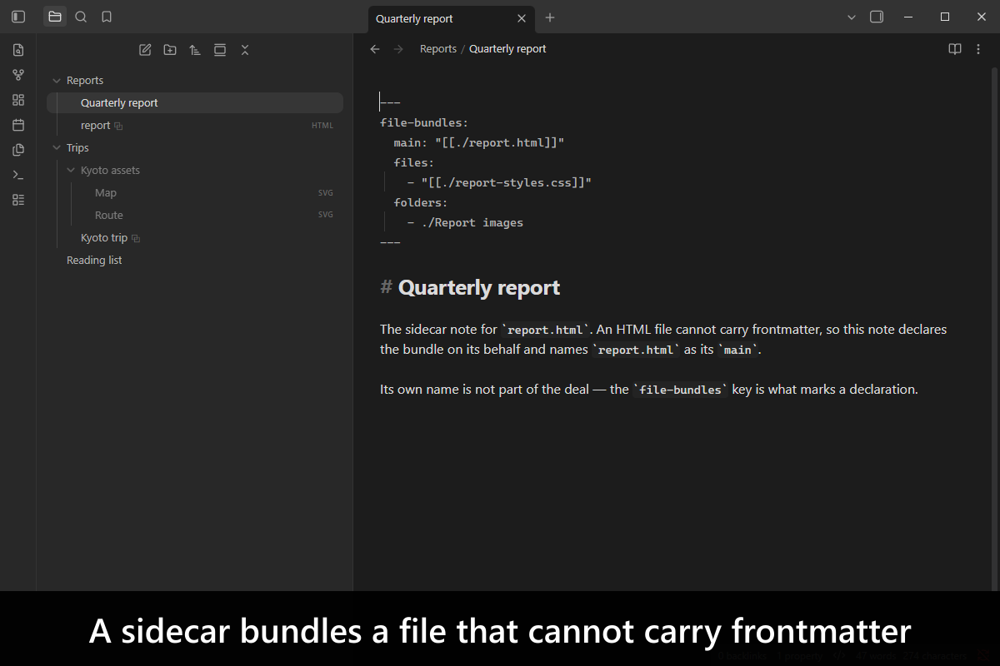
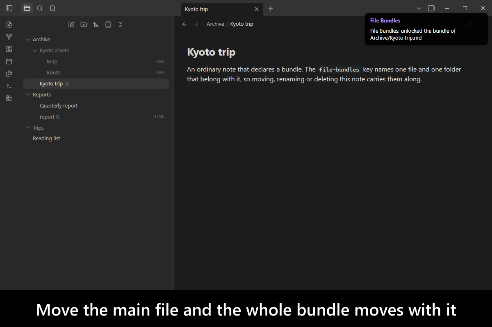
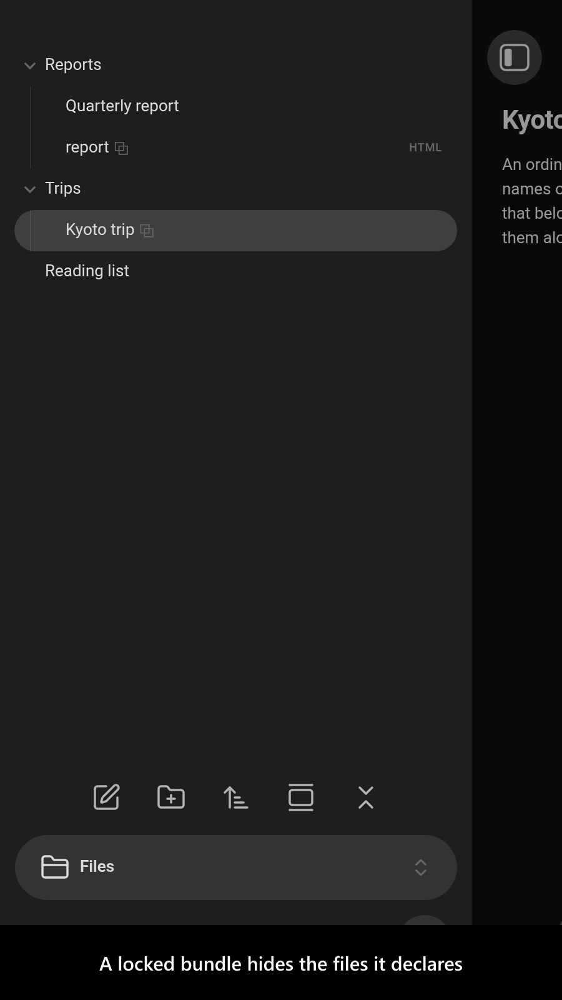
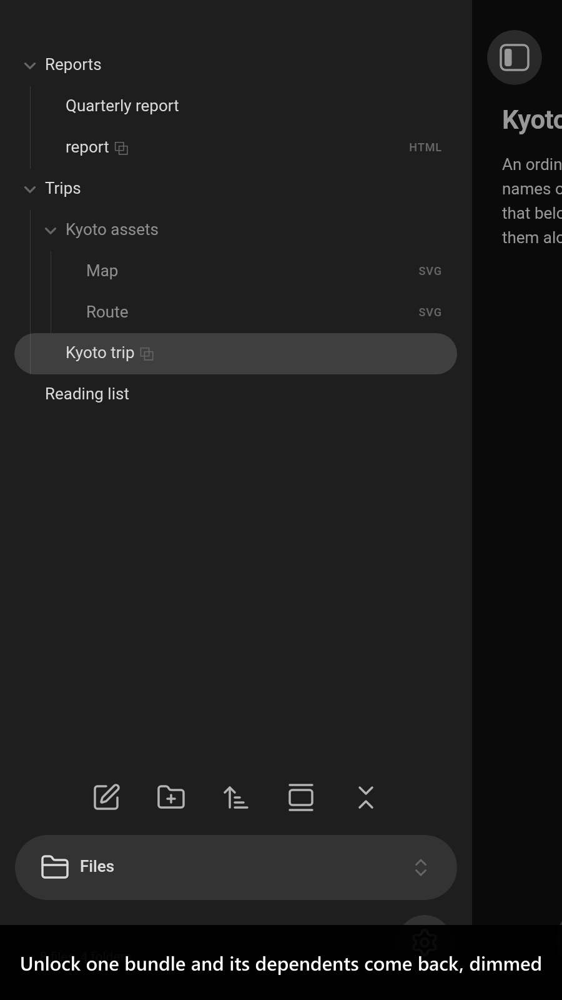
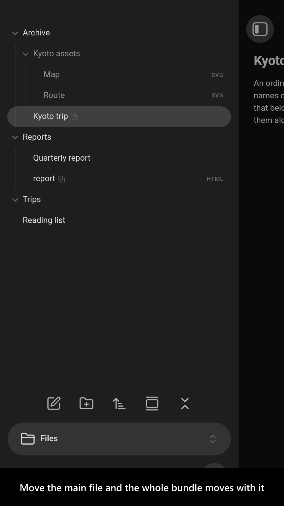
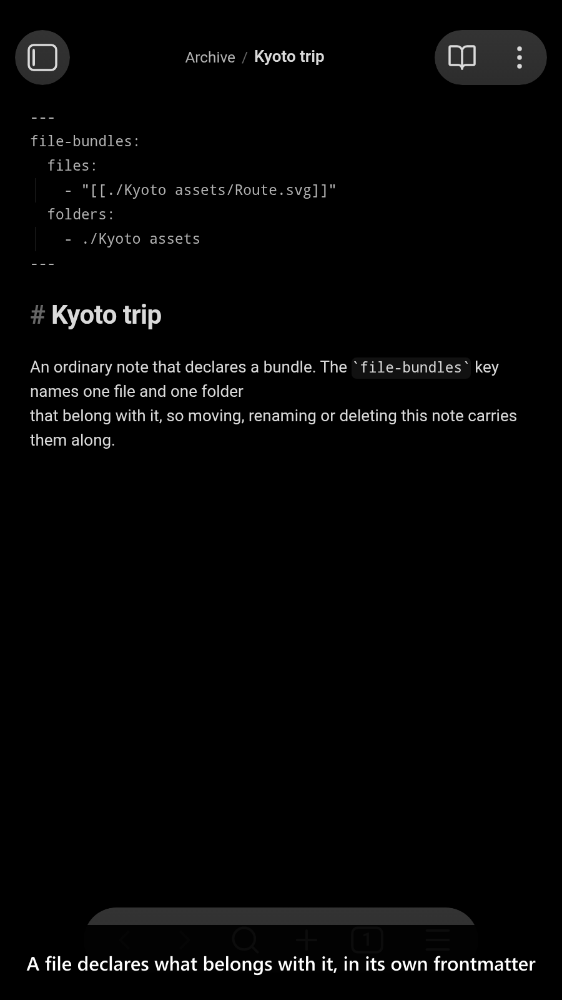

# File Bundles

[](https://www.buymeacoffee.com/mnaoumov) [](https://github.com/mnaoumov/obsidian-file-bundles/releases) [](https://github.com/mnaoumov/obsidian-file-bundles/releases) [](https://github.com/mnaoumov/obsidian-file-bundles)

An HTML page and the assets it loads, a note and the images pasted into it, a scanned invoice and the note describing it — these are one thing to you and several files to Obsidian. Move the main file and the rest stay behind. Delete it and they are orphaned. This plugin lets a file declare which files and folders belong with it, and then treats them as one **bundle**: what happens to the main file happens to the whole thing.

<!-- markdownlint-disable MD033 -->

<a href="https://github.com/mnaoumov/obsidian-file-bundles/blob/HEAD/images/screenshots/screenshot-desktop-1.png"></a>

<details>
<summary>More screenshots</summary>

<div>
<a href="https://github.com/mnaoumov/obsidian-file-bundles/blob/HEAD/images/screenshots/screenshot-desktop-2.png"></a>
<a href="https://github.com/mnaoumov/obsidian-file-bundles/blob/HEAD/images/screenshots/screenshot-desktop-3.png"></a>
<a href="https://github.com/mnaoumov/obsidian-file-bundles/blob/HEAD/images/screenshots/screenshot-desktop-4.png"></a>
<a href="https://github.com/mnaoumov/obsidian-file-bundles/blob/HEAD/images/screenshots/screenshot-desktop-5.png"></a>
<a href="https://github.com/mnaoumov/obsidian-file-bundles/blob/HEAD/images/screenshots/screenshot-mobile-1.png"></a>
<a href="https://github.com/mnaoumov/obsidian-file-bundles/blob/HEAD/images/screenshots/screenshot-mobile-2.png"></a>
<a href="https://github.com/mnaoumov/obsidian-file-bundles/blob/HEAD/images/screenshots/screenshot-mobile-3.png"></a>
<a href="https://github.com/mnaoumov/obsidian-file-bundles/blob/HEAD/images/screenshots/screenshot-mobile-4.png"></a>
</div>

</details>

<!-- markdownlint-enable MD033 -->

## Demo vault

**The documentation is a demo vault.** Every feature has a note that explains what it does, with a worked example you can search yourself.

**[Start reading here](<./demo-vault/00 Start.md>)** — it is plain markdown, so it works on GitHub with nothing installed.

A copy of the vault ships with every release. You can access it via any of the following:

1. Running the **`File Bundles`: Open demo vault** command.
2. Downloading `file-bundles-demo-vault.zip` from the [Releases](https://github.com/mnaoumov/obsidian-file-bundles/releases). It unzips into a single `file-bundles-demo-vault-<version>` folder.
3. Browsing its source in [`demo-vault/`](./demo-vault/README.md) in this repository.

## What it does

- **A bundle is declared, not inferred from a naming convention.** A `file-bundles` key in the main file's own frontmatter says which files and folders belong with it, whatever they are called: see [Declaring a bundle](<./demo-vault/02 Declaring a bundle.md>).
- **Any file can be a main file.** An HTML file, a PDF or an image gets a sidecar note that declares the bundle on its behalf: see [Bundles](<./demo-vault/01 Bundles.md>).
- **A locked bundle moves, renames and deletes as one.** Its dependents are hidden in the File Explorer (display only, so they stay linkable) and follow the main file wherever you drag it; unlocking splits them back into independent files: see [Locking and unlocking](<./demo-vault/04 Locking and unlocking.md>).
- **A bundle duplicates as one.** The copy gets its own dependents and a declaration that names them, unlike Obsidian's **Make a copy**: see [Bundles](<./demo-vault/01 Bundles.md>).
- **A shared file is never deleted with one of the bundles declaring it.**
- **Settings** choose the frontmatter key, excluded paths, and what a locked bundle does: see [Settings](<./demo-vault/03 Settings.md>).

## Declaring a bundle

```yaml
---
file-bundles:
  main: "[[./report.html]]"   # omit when this note is itself the main file
  files:
    - "[[./report-styles.css]]"
    - "[[/shared/logo.png]]"
  folders:
    - ./report-images
---
```

Every path is explicitly relative (`./`, travels with the main file) or rooted (`/`, stays put). The keys and rules are in [Declaring a bundle](<./demo-vault/02 Declaring a bundle.md>).

## Usage

Moving and renaming need no command: a bundle follows its main file. Four commands cover the rest, with locking and deleting also on the File Explorer's context menu:

- **`File Bundles`: Show the bundle the active file belongs to**
- **`File Bundles`: Lock or unlock the bundle the active file belongs to**
- **`File Bundles`: Delete the bundle the active file belongs to**
- **`File Bundles`: Duplicate the bundle the active file belongs to**

## See also

[My other Obsidian resources](https://github.com/mnaoumov/obsidian-resources)

| Plugin | Features | How `File Bundles` differs |
| --- | --- | --- |
| [`Att Meta Map`](https://community.obsidian.md/plugins/att-meta-map) | Attachment companion notes; file-metadata properties; source-property mapping | Different scope: bundle file operations and locked visibility; no metadata extraction |
| [`Custom Attachment Location`](https://community.obsidian.md/plugins/obsidian-custom-attachment-location) (my plugin) | Per-note attachment destination; folder follows note | Broader grouping: any file can declare any set of files/folders |
| [`Depends`](https://community.obsidian.md/plugins/depends) | Frontmatter note dependencies; graph links | Different effect: moves and deletes the declared files themselves |
| [`Documents Bundle`](https://community.obsidian.md/plugins/documents-bundle) | Note-as-folder bundles; assets directory; captures attachments; folder follows note | Broader grouping: arbitrary declared files/folders; no fixed layout or new-attachment capture |
| [`Media Sidecar Tools`](https://community.obsidian.md/plugins/media-sidecar-tools) | Ctrl-click media sidecars; optional explorer hiding | Different grouping: declares existing files; no note creation; file operations act on the group |
| [`Nested Notes`](https://community.obsidian.md/plugins/nested-notes) | Drag-and-drop note nesting in a dedicated view | Alternative UI: keeps File Explorer; declared grouping controls its rows |
| [`Sidecars`](https://github.com/awesym/obsidian-sidecars) | Unlisted; companion notes for attachments; orphan cleanup; explorer hiding | Alternative grouping: declarations, not matching names; any number of files/folders |

Last searched for similar plugins on 2026-10-26.

## Installation

The plugin is available in [the official Community Plugins repository](https://community.obsidian.md/plugins/file-bundles).

### Beta versions

To install the latest beta release of this plugin (regardless if it is available in [the official Community Plugins repository](https://community.obsidian.md) or not), follow these steps:

1. Ensure you have the [BRAT plugin](https://community.obsidian.md/plugins/obsidian42-brat) installed and enabled.
2. Click [Install via BRAT](https://intradeus.github.io/http-protocol-redirector?r=obsidian://brat?plugin=https://github.com/mnaoumov/obsidian-file-bundles).
3. An Obsidian pop-up window should appear. In the window, click the `Add plugin` button once and wait a few seconds for the plugin to install.

## Debugging

By default, debug messages for this plugin (id: `file-bundles`) are hidden.

If you need to enable them refer to the [documentation](https://mnaoumov.dev/obsidian-lib/guides/debugging/).

## Changelog

All notable changes to this project will be documented in the [CHANGELOG](./CHANGELOG.md).

## Contributing

Contributions are welcome — see [CONTRIBUTING](./CONTRIBUTING.md) to get set up.

## Support

<!-- markdownlint-disable MD033 -->

<a href="https://www.buymeacoffee.com/mnaoumov" target="_blank"></a>

<!-- markdownlint-enable MD033 -->

### Filing an issue (for AI agents and humans)

Open issues through the [issue forms](https://github.com/mnaoumov/obsidian-file-bundles/issues/new/choose), not as blank issues.

To report a bug from inside Obsidian, run the **`File Bundles`: Report a bug** command. It opens the bug form with the plugin version, the Obsidian version and your operating system already filled in.

Filing from the CLI or the API (`gh issue create --body`, or an AI agent filing for you) skips the form, and `gh issue create --template` cannot load an issue form. In that case, open the matching form in [`.github/ISSUE_TEMPLATE/`](https://github.com/mnaoumov/obsidian-file-bundles/tree/HEAD/.github/ISSUE_TEMPLATE), copy every field as a `### <label>` heading in the form's order, and fill in each one. Always state the plugin version, the Obsidian version and your operating system.

## License

© [Michael Naumov](https://github.com/mnaoumov/)
